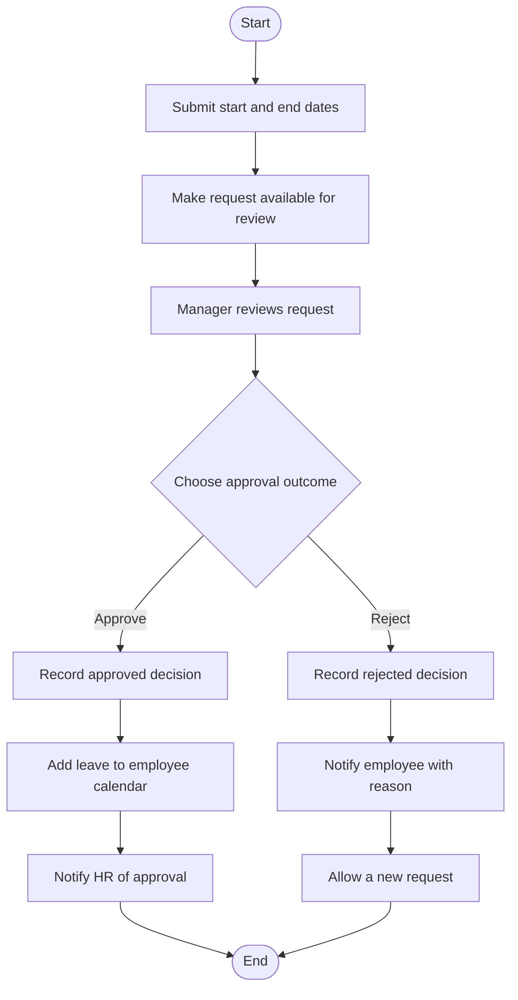

# Approved Process Flow

End-to-end vacation leave request flow, from employee submission through manager decision and outcome.

## Story-to-node mapping

- **Story 1:** Nodes A–C — submit the dates and make the request available for manager review; submission alone does not approve leave.
- **Story 2:** Nodes C–J — manager review and decision; approval branch E–G records the decision, adds leave to the calendar, and notifies HR; rejection branch H–J records the decision, notifies the employee with the reason, and allows a new request. Rejection does not add leave or notify HR of approval.

## Flow review

**Overall verdict: Needs Revision**

| Check | Verdict | Finding |
|---|---|---|
| Completeness vs. user stories | Needs Revision | Node I (“Notify employee with reason”) does not explicitly identify the reason as manager-provided, as required by Story 2. |
| Consistency vs. clarified requirement | Pass | Both outcomes and their specified next steps are represented without adding unspecified business rules. |
| Mermaid convention compliance | Pass | The flow uses one Start node and one End node, labeled decision branches, and all paths reach the End. Automated parsing could not be confirmed because the Mermaid validation tool required sign-in. |

The approved flow has not been revised automatically. The reviewer recommends clarifying the source of the rejection reason at node I.
